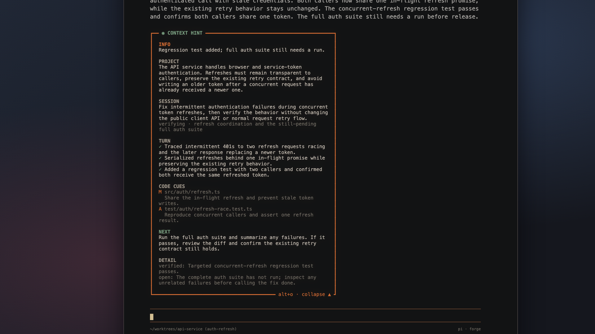

<p align="center"></p>

<h1 align="center">Context Hint for Pi</h1>

**Pick up a Pi session without rereading its transcript.** Context Hint adds a compact Project / Session / Turn card after a settled interaction, surfacing the project's purpose, session goal, recent change, and a possible next step.

I built it after switching between projects, worktrees, and agent sessions left me spending too long reconstructing what I had left behind.

## Demo

[](assets/context-hint-demo.mp4)

[Watch the 18-second demo with sound](assets/context-hint-demo.mp4) (18 seconds, about 32 MB; depending on your browser, it may play or download).

*The demo uses fictional project details; it is illustrative, not an actual screen recording. [Open the static still](assets/context-hint-still.png) independently.*

## A typical switch

Imagine an API fix in one worktree and a UI change in another. Leave the API session while work continues, switch to the UI, then return. Instead of reconstructing the API thread from earlier messages, read its last Context Hint card to see what changed and what might come next.

The card is a **human-facing recovery cue**, not a cross-session dashboard: it does not monitor other agents or alert you when they finish. It appears in each enabled Pi session after an interaction settles. Earlier cards remain in that session's transcript; `alt+o` expands or collapses them.

## Try it

Context Hint is a [Pi coding agent](https://pi.dev/) TUI extension. With Pi and Bun installed, run it from a local checkout today:

```bash
bun install
bun run build
pi -e ./dist/context-hint.js
```

Generation starts **disabled**. Enabling it sends selected interaction evidence and previous Project / Session state to a summary model after each settled turn, normally in one extra request. [See model use, cost, and privacy details](#model-use-token-cost-and-context). In Pi, run:

```text
/context-hint enable
```

Continue working normally. After the next settled interaction, a Context Hint card appears. Use `/context-hint model` if you want a dedicated summary model instead of Pi's current model.

The package is private and **not published yet**. Keep this placeholder command for when a package name is assigned:

```bash
pi install npm:@your-scope/pi-context-hint
```

## What the three layers mean

| Layer | What it helps you recover | Where it follows you |
| --- | --- | --- |
| **Project** | Durable purpose, constraints, and decisions | Shared across sessions and Git worktrees of the same repository |
| **Session** | Current goal, focus, blockers, and next steps | Follows the active Pi session branch; forks and clones inherit a snapshot, then diverge |
| **Turn** | What was accomplished or learned in the settled interaction | Shown in that interaction's card |

A new Pi session starts without the previous session's rolling Session Context; Project Context remains available for that repository. Different repositories have separate Project Context. Turn summaries use selected evidence from the current interaction, not a replay of the full conversation.

## Commands

| Command | Purpose |
| --- | --- |
| `/context-hint` | Open the command menu |
| `/context-hint status` | Show current configuration |
| `/context-hint enable` / `disable` | Start or stop future generation; disabling keeps existing state |
| `/context-hint model` | Choose the summary model or inherit Pi's current model |
| `/context-hint regenerate` | Regenerate the latest settled hint |
| `/context-hint toggle` or `alt+o` | Expand or collapse cards |
| `/context-hint motion reduce` / `motion animate` | Disable or enable spinner and eye animation |
| `/context-hint reset-session` | Reset rolling Session Context |
| `/context-hint reset-project` | Reset durable Project Context for this project |

## Model use, token cost, and context

**This uses an extra model request, not free local summarization.** When enabled in a Pi TUI, a settled interaction normally makes one request to the selected summary model. If its response fails validation, Context Hint can make one repair request to the same model. Manual regeneration also requests a new summary. By default the extension inherits Pi's current model; use `/context-hint model` to select an available, lower-cost model if that suits your summaries. There is no automatic fallback to another model.

**Input is selected and truncated, not the full transcript.** Evidence can include up to 4,000 characters of the current user prompt, 6,000 combined characters of assistant text, the first 24 tool facts (each with truncated input and text output), and short excerpts of `CONTEXT.md`, `README.md`, and `package.json` when present. Previous Project and Session state is also included. The serialized generation prompt is truncated to 20,000 JavaScript string units; the validation-repair request adds instructions. Each request sets `maxTokens: 3,500` for output. These are character/item limits on input and a requested output-token limit, **not a strict input-token or billing ceiling**.

For a rough English-language illustration: if the *assembled* prompt for one turn is about 8,000 characters, it might be around 2,000 input tokens, plus system instructions and tool schema; a short result might use a few hundred output tokens. A near-20,000-character prompt might instead be on the order of 5,000 English input tokens before that overhead. Code, non-English text, model tokenizers, and a possible second repair request change the numbers. Context Hint does not record token usage or cost, so these examples are **not measured usage or a price estimate**. Your provider's usage data is the source for actual cost.

Cards are custom transcript entries for **you**: their rendered text is not automatically inserted into ordinary later agent prompts. Summary generation is different: it sends the previous Project / Session state and selected current-turn evidence to the chosen model so it can update the card. Context Hint therefore avoids replaying entire transcripts into ordinary future model context, but it still consumes tokens and shares data with the summary model on each generation.

## Data and privacy

Context Hint stores settings and per-project state under Pi's agent data directory (`context-hint/settings.json` and `context-hint/projects/<project-id>/`), outside the repository. Generation records contain selected evidence, generated hints, and state snapshots. They are local files, **not encrypted by this extension**; historical generation records are not automatically pruned. Resetting Session or Project Context does **not** delete those historical records.

Before sending a prompt to the chosen model, Context Hint applies pattern-based redaction for some recognizable keys, tokens, and private-key blocks, then truncates the evidence. This can miss secrets. Model-generated fields are validated against a schema but are **not redacted again before storage**. Do not rely on this extension to protect data that must not reach the selected model or remain in local records. Pi extensions run with full system access; review source before installing.

## Troubleshooting

- No card appears: run `/context-hint status` and confirm generation is enabled; cards are generated after settled interactions in the Pi TUI.
- No model is selected or the configured model is unavailable: run `/context-hint model`.
- Latest generation failed: run `/context-hint regenerate` after a settled interaction.
- Context is stale: reset Session Context first; reset Project Context only if durable project knowledge needs clearing. Resets do not erase historical generation records.

## Contributing

Development setup, tests, type checking, build, packaging, and the manual Pi smoke checklist live in [`CONTRIBUTING.md`](./CONTRIBUTING.md).

## License

MIT. See [`LICENSE`](./LICENSE).
